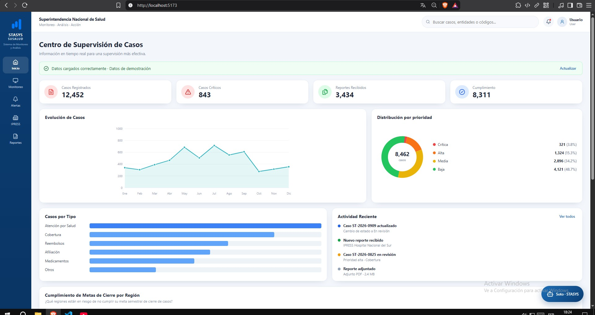
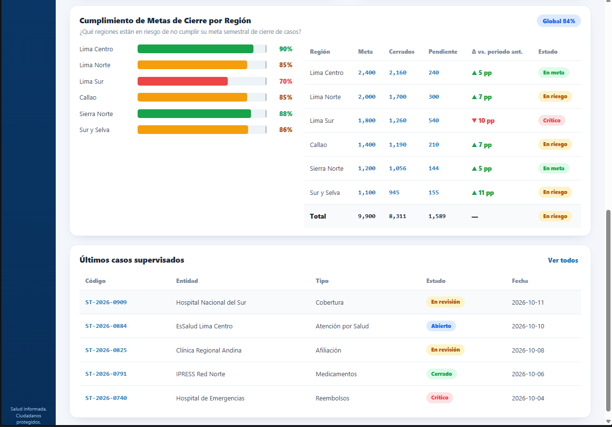
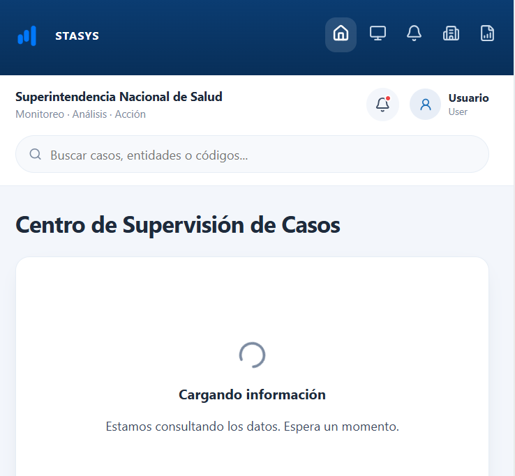
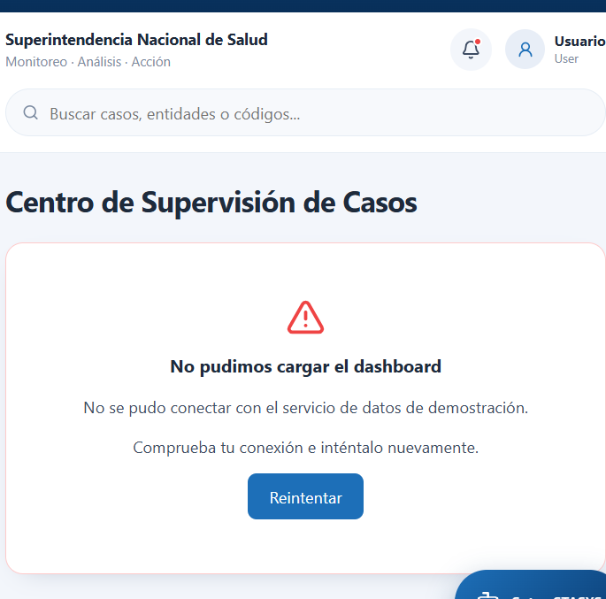
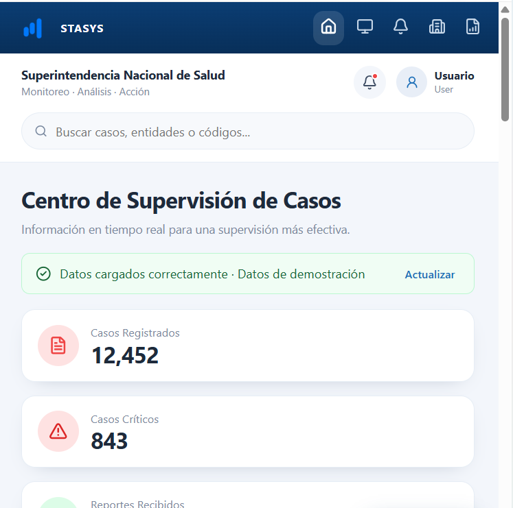
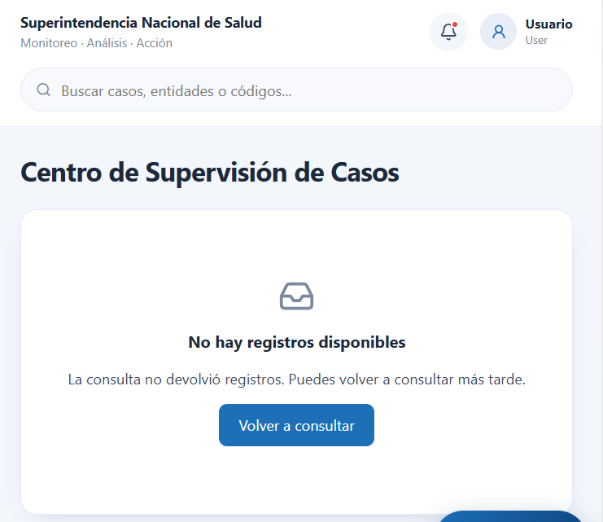
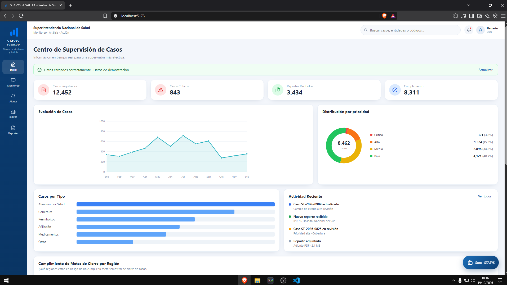
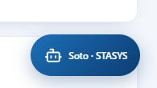
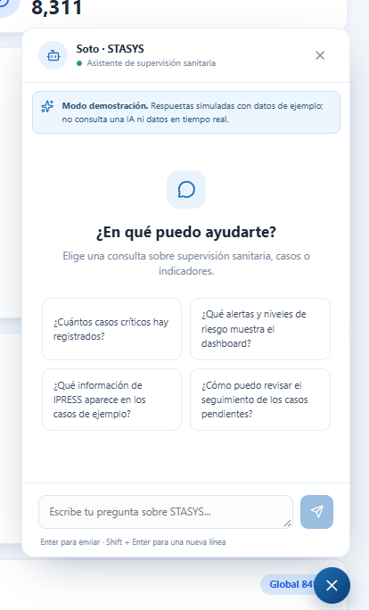
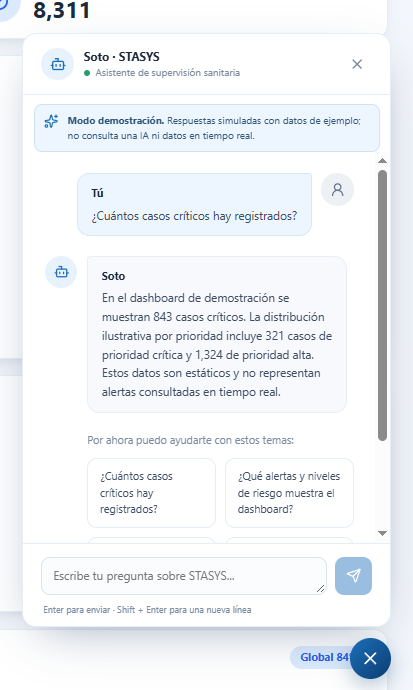

# STASYS Dashboard
Dashboard de STASYS SUSALUD (Centro de Supervisión de Casos) con datos de consultas y denuncias para la organización inicial del frontend en React + Vite.

## KPIs de negocio
Los indicadores clave de rendimiento (KPIs) permiten resumir la información disponible y facilitar el seguimiento analítico de los casos relacionados con la protección de los derechos en salud. Para esta versión del dashboard, se utilizan datasets que contienen fechas de registro, tipos de solicitud, datos generales del solicitante e información de las instituciones involucradas.

### KPI 1. Total de solicitudes registradas

| Elemento | Descripción |
|---|---|
| **Nombre del KPI** | Total de solicitudes registradas |
| **Información** | Cuenta la cantidad de registros incluidos en el conjunto de datos procesado. Permite conocer el volumen de consultas, denuncias y otros tipos de solicitud registrados durante el período analizado. |
| **Origen de datos** | Capa Gold: tabla de resumen general generada por Spark. Campo de referencia: `FE_REGISTRO`. La métrica cuenta los registros del conjunto procesado. |
| **Fórmula** | \(N = \text{COUNT(*)}\) sobre los registros incluidos en el período y conjunto de datos seleccionados. |
| **Toma de decisión** | Permite dimensionar el volumen de solicitudes y contextualizar los demás indicadores del dashboard. También facilita comparar períodos cuando se dispone de datos correspondientes a cada uno. |

### KPI 2. Distribución de solicitudes por tipo

| Elemento | Descripción |
|---|---|
| **Nombre del KPI** | Distribución de solicitudes por tipo |
| **Información** | Calcula la cantidad y proporción de registros de cada categoría de solicitud, como `Consulta`, `Denuncia` e `Intervencion de oficio`, según los valores disponibles en los datos. |
| **Origen de datos** | Capa Gold: tabla `casos_por_tipo`, generada mediante el agrupamiento del campo `DE_TIPO_SOLICITUD`. |
| **Fórmula** | Cantidad por tipo: `COUNT(*)` agrupado por `DE_TIPO_SOLICITUD`. Porcentaje por tipo: `(cantidad del tipo / total de registros clasificados) × 100`. |
| **Toma de decisión** | Permite identificar qué categorías concentran la mayor cantidad de solicitudes y orientar el análisis y la distribución de la atención según el volumen observado. No determina por sí solo la urgencia ni la prioridad de un caso. |

### KPI 3. Concentración de solicitudes por institución

| Elemento | Descripción |
|---|---|
| **Nombre del KPI** | Concentración de solicitudes por institución |
| **Información** | Calcula la cantidad de registros asociados a cada institución, lo que permite identificar cuáles concentran un mayor volumen de solicitudes en el período analizado. |
| **Origen de datos** | Capa Gold: tabla `casos_por_institucion`, utilizando `CO_INSTITUCION` y `DE_INSTITUCION`. |
| **Fórmula** | `COUNT(*)` agrupado por código y nombre de institución. |
| **Toma de decisión** | Facilita identificar instituciones con mayor volumen de solicitudes y priorizar su revisión analítica o seguimiento institucional. Una concentración elevada representa un volumen observado, no una prueba de incumplimiento. |

### KPI 4. Distribución geográfica de solicitudes

| Elemento | Descripción |
|---|---|
| **Nombre del KPI** | Distribución geográfica de solicitudes |
| **Información** | Calcula la cantidad de registros por ubicación de la institución involucrada. Permite examinar cómo se distribuyen territorialmente las solicitudes. |
| **Origen de datos** | Capa Gold: tabla `casos_por_ubigeo`, basada en el campo `DE_UBIGEO_INST`. |
| **Fórmula** | `COUNT(*)` agrupado por ubicación. |
| **Toma de decisión** | Permite identificar ubicaciones que concentran solicitudes y orientar análisis territoriales posteriores. Los valores vacíos o representados por `-` deben tratarse como ubicaciones no disponibles, no como una ubicación geográfica real. |

### KPI 5. Tendencia mensual de solicitudes

| Elemento | Descripción |
|---|---|
| **Nombre del KPI** | Tendencia mensual de solicitudes registradas |
| **Información** | Calcula la cantidad de registros por mes a partir de la fecha de registro. Permite observar cambios en el volumen de solicitudes a lo largo del tiempo. |
| **Origen de datos** | Capa Gold: tabla `tendencia_mensual`, derivada del campo `FE_REGISTRO`, previa validación y normalización de su formato de fecha. |
| **Fórmula** | `COUNT(*)` agrupado por año y mes de registro. |
| **Toma de decisión** | Permite detectar aumentos o disminuciones del volumen registrado y seleccionar períodos que requieran un análisis más detallado. La variación observada no demuestra por sí sola una causa específica. |

### Resumen de los KPIs

| KPI | Métrica principal | Visualización sugerida |
|---|---|---|
| Total de solicitudes registradas | Número total de registros | Tarjeta de indicador |
| Distribución por tipo | Cantidad y porcentaje por categoría | Gráfico de barras o dona |
| Concentración por institución | Registros por institución | Tabla ordenada o gráfico de barras |
| Distribución geográfica | Registros por ubicación | Gráfico de barras o mapa, si se dispone de datos geográficos adecuados |
| Tendencia mensual | Registros por mes | Gráfico de líneas |

### Consideraciones sobre los datos

- **Cobertura:** los resultados dependen del período y de los registros incluidos en el dataset utilizado.
- **Integridad:** campos incompletos, como `DE_TIPO_INST` o `DE_NATURALEZA_INST`, pueden limitar ciertos desgloses y deben identificarse durante la validación.
- **Fechas:** `FE_REGISTRO` debe convertirse a un formato de fecha consistente antes de calcular tendencias temporales.
- **Instituciones:** se recomienda agrupar por `CO_INSTITUCION` y utilizar `DE_INSTITUCION` como descripción para evitar duplicidades por diferencias de escritura en los nombres.
- **Interpretación:** estos indicadores miden volumen y distribución de registros. No representan automáticamente casos críticos, incumplimientos, tiempos de atención ni resoluciones.
- **Alcance:** los KPIs son indicadores analíticos propuestos para el proyecto STASYS. No deben interpretarse como umbrales oficiales de SUSALUD.

## Integración de API en el frontend

El frontend contempla una estrategia de simulación temporal mediante datos MOCK, para permitir el desarrollo y la validación de los componentes visuales mientras se implementa la API del backend STASYS en Java 17 y Spring Boot.

### Configuración

- `VITE_USE_MOCK_API=true`: utiliza datos de demostración locales.
- `VITE_USE_MOCK_API=false`: habilita las peticiones HTTP hacia el backend configurado.
- `VITE_API_BASE_URL`: define la URL base del backend; por defecto, `http://localhost:8080`.

### Endpoints pendientes

| Método | Endpoint | Estado |
|---|---|---|
| GET | `/api/v1/dashboard/kpis` | Pendiente de implementación |
| GET | `/api/v1/dashboard/solicitudes-por-tipo` | Pendiente de implementación |
| GET | `/api/v1/dashboard/solicitudes-por-institucion` | Pendiente de implementación |
| GET | `/api/v1/dashboard/tendencia-mensual` | Pendiente de implementación |
| GET | `/api/v1/dashboard/solicitudes-por-ubicacion` | Pendiente de implementación |
| GET | `/api/v1/dashboard/metadata` | Pendiente de implementación |

Las rutas anteriores son contratos propuestos para la integración y no implican que los controladores estén disponibles actualmente en el backend. Antes de cambiar a modo real, deben implementarse los endpoints, verificar los formatos de respuesta y configurar CORS cuando frontend y backend se ejecuten en orígenes distintos.

Los datos MOCK son exclusivamente demostrativos.

## Nota

El dashboard actual utiliza datos locales para fines de demostración. Esta versión no consume un backend ni una API real. La navegación lateral es una maqueta visual; la vista implementada es el dashboard de supervisión.

Los KPIs descritos definen las métricas que se busca representar. Su disponibilidad efectiva en el dashboard depende de que las agregaciones correspondientes estén implementadas y de que los datos procesados se encuentren disponibles para la aplicación.

# Manejo de Estados de Interfaz

El manejo de los estados de interfaz es fundamental para la experiencia de usuario (UX). Estos estados permiten comunicar al usuario el resultado de sus acciones o el estatus actual del sistema.

## Estados Implementados

*   **Estados de Carga (Loading):** Indican que el sistema está procesando una solicitud. Esto evita que el usuario piense que la aplicación se ha congelado o que no está ocurriendo nada.

*   **Mensajes de Error:** Informan al usuario cuando un servicio, proceso o funcionalidad ha fallado en su ejecución.

*   **Mensajes de Éxito:** Confirman al usuario que un proceso o acción se ha realizado correctamente.

*   **Estados de "Vacío" (Empty States):** Cuando un componente (como una lista o tabla) no tiene información, es recomendable mostrar un mensaje explicativo. Esto ayuda a que el usuario comprenda por qué no ve datos y evita que lo confunda con un error del sistema.

## Beneficios
Implementar estos estados nos permite:
1.  **Mejorar la claridad visual:** Distinguir claramente entre errores, éxitos y procesos en curso.
2.  **Reducir la incertidumbre:** El usuario siempre sabe qué está pasando con su interacción.
3.  **Prevenir errores:** Gracias a las alertas preventivas, el usuario puede tomar decisiones más informadas, minimizando la posibilidad de cometer errores accidentales.

## Manejo de estados de interfaz

La vista consulta sus datos de forma asíncrona y presenta cuatro estados excluyentes:
- Carga: indicador animado y mensaje accesible mientras espera la respuesta.
- Vacío: mensaje cuando no existen registros, con opción de volver a consultar.
- Error: aviso ante fallos de conexión, HTTP 404/500 o respuesta inválida, con reintento.
- Éxito: confirmación y renderizado del dashboard; el botón Actualizar inicia una nueva consulta.

Con `VITE_USE_MOCK_API=true` (predeterminado), se conservan los datos locales de demostración. Para revisar cada escenario abre `/?estado=carga` (10 segundos), `/?estado=vacio`, `/?estado=error` o `/` (éxito después de 700 ms). Los escenarios de vacío y error se mantienen al reintentar mientras esté presente el parámetro; elimínalo para recuperar la vista normal.

Con `VITE_USE_MOCK_API=false`, la vista utiliza `GET ${VITE_API_BASE_URL}/api/v1/dashboard`. Este es un **contrato agregado propuesto, pendiente de implementar en el backend**; los endpoints individuales existentes permanecen disponibles para futura integración. La respuesta esperada contiene las métricas `registeredCases`, `criticalCases`, `receivedReports`, `compliance`, `totalPriorityCases` y los arreglos `casesByMonth`, `casesByPriority`, `casesByType`, `recentActivity`, `supervisedCases`, `regionGoals`, con la estructura de `src/features/dashboard/data/casesData.js`. Una respuesta 204, `null`, `[]` o métricas sin registros y arreglos vacíos produce el estado vacío. Las consultas se cancelan al desmontar la vista para evitar actualizaciones tardías.

## Interfaz del agente de IA Soto

Como parte del desarrollo de STASYS (Sistema de Monitoreo y Análisis), se integró en el dashboard una interfaz de asistente virtual llamada **Soto**. El acceso se realiza desde un botón flotante, por lo que es posible abrir el chat sin abandonar la pantalla principal.

### Funcionalidades implementadas

- **Integración visual:** acceso al asistente desde la pantalla principal del dashboard.
- **Ventana de conversación:** panel que se puede abrir y cerrar desde el botón flotante.
- **Mensaje de bienvenida y consultas sugeridas:** orientación inicial y preguntas predefinidas sobre indicadores, casos, alertas e IPRESS de ejemplo.
- **Interacción mediante mensajes:** envío de consultas y presentación diferenciada de los mensajes del usuario y de Soto.
- **Indicador de procesamiento:** animación mientras se prepara la respuesta.
- **Diseño adaptable:** ajustes para visualizar el chat en pantallas de distintos tamaños.
- **Identidad visual:** uso del logotipo de STASYS en la interfaz y como favicon del navegador.

### Evidencias de la interfaz

Guarda las capturas en `src/assets/Screenshots/` con estos nombres. Al añadir los archivos, las imágenes se mostrarán aquí automáticamente:

#### Dashboard principal de STASYS

Evidencia de la pantalla principal y de la identidad visual del sistema.

#### Acceso flotante al asistente Soto

Evidencia del botón flotante que permite iniciar una interacción sin cambiar de sección.

#### Ventana inicial del asistente virtual

Evidencia del panel conversacional, el mensaje de bienvenida y las consultas sugeridas.

#### Interacción entre el usuario y el asistente

Evidencia del envío de una consulta y de la respuesta presentada en el chat.

### Tecnologías utilizadas

- **React:** componentes e interfaz interactiva.
- **JavaScript:** lógica de interacción y gestión de mensajes.
- **CSS:** estilos, distribución y adaptación de la interfaz.
- **Lucide React:** iconos de acciones y elementos visuales.
- **Vite:** entorno de desarrollo y compilación del frontend.

### Estado actual y limitaciones

La interfaz de Soto permite demostrar el flujo de conversación desde el dashboard, pero sus respuestas son **simuladas** y se generan en el frontend con lógica y datos locales. Actualmente no está conectada a un modelo de inteligencia artificial ni a un servicio backend para procesar consultas reales. Por ello, las respuestas no deben interpretarse como información oficial ni como datos actualizados en tiempo real.

### Próximas actividades

- Integrar el asistente con un servicio de inteligencia artificial.
- Definir una comunicación segura con los servicios autorizados de STASYS.
- Preparar las consultas para utilizar datos reales y autorizados.
- Validar la precisión, pertinencia y consistencia de las respuestas.
- Realizar pruebas funcionales, de usabilidad y de adaptación a distintos dispositivos.
